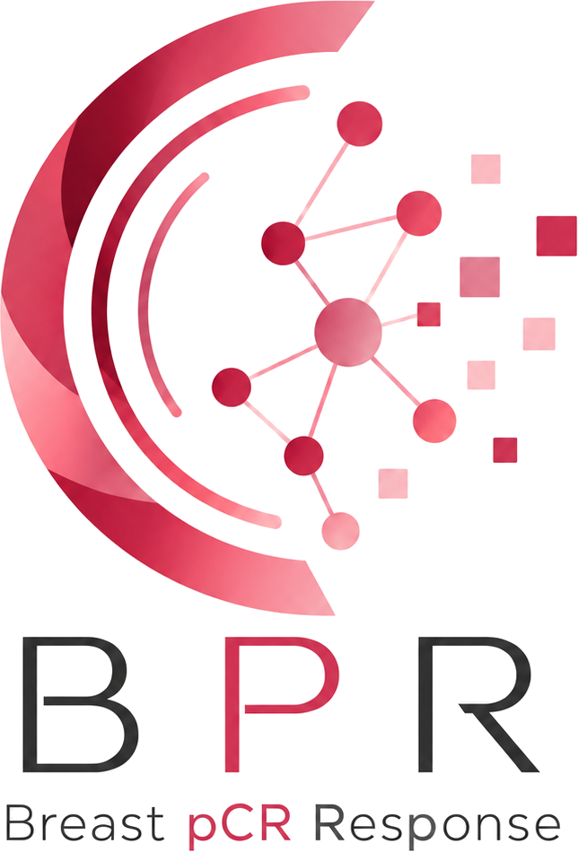
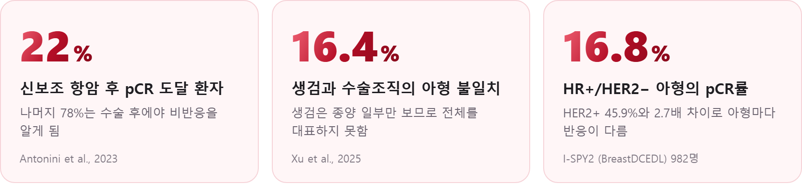
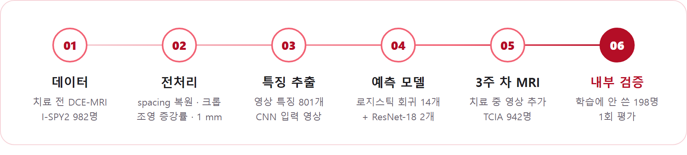
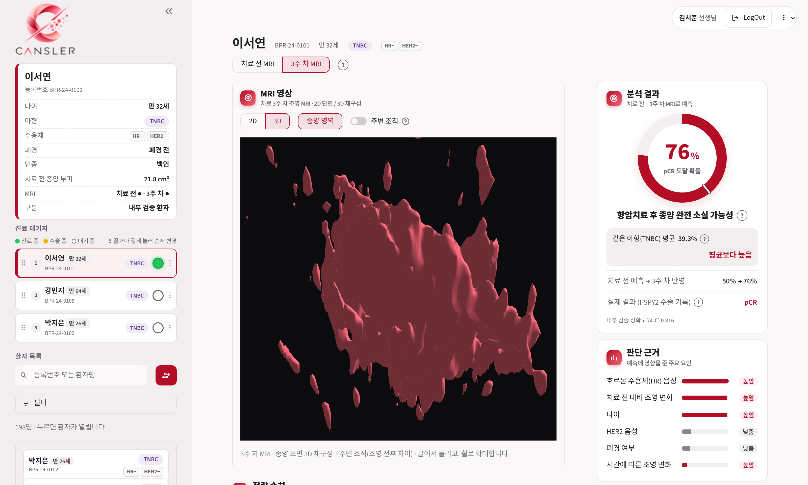
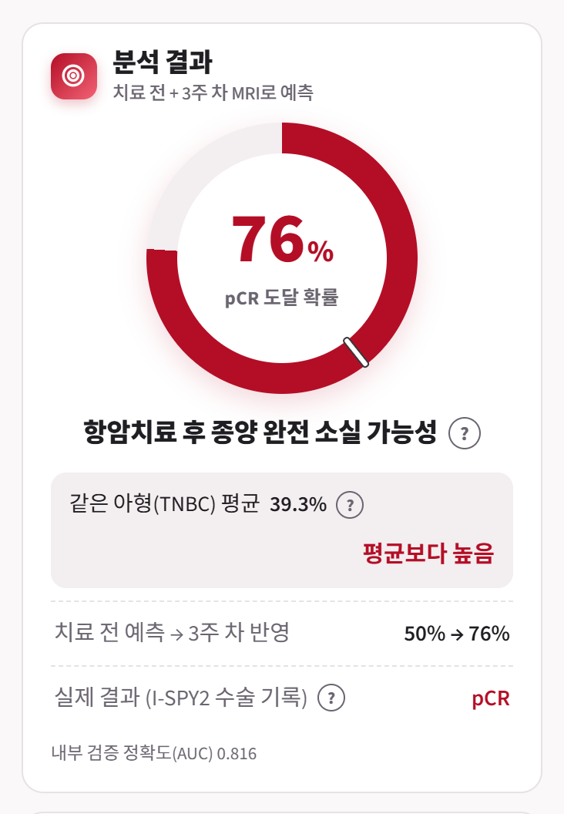
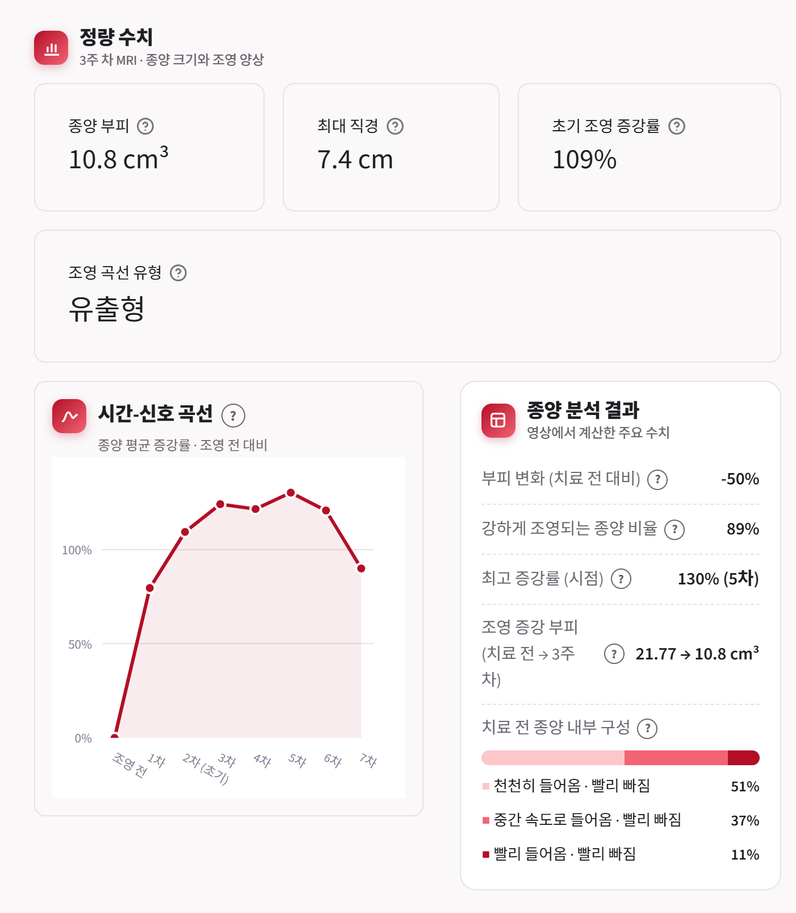

<div align="center">

<picture>
  <source media="(prefers-color-scheme: dark)" srcset="assets/bpr-logo-response-dark.png" />
  
</picture>

<h2>BPR — Breast pCR Response</h2>

<p>
<b>치료 전 유방 MRI로 신보조 항암치료의 완전관해(pCR)를 예측하고,<br/>
영상이 기존 임상 정보를 넘어 예측에 기여하는지 검증합니다.</b>
</p>

<p>
<sub><i>Predicting pathologic complete response (pCR) to neoadjuvant chemotherapy in breast cancer
from pre-treatment DCE-MRI, and testing whether imaging adds value beyond clinical variables.</i></sub>
</p>

<p>


</p>

<p>

</p>

<p>
<a href="#problem">문제 정의</a> ·
<a href="#approach">접근 방법</a> ·
<a href="#data">데이터셋</a> ·
<a href="#results">결과</a> ·
<a href="#code">코드 구성</a> ·
<a href="#web">웹앱 · 결과 읽는 법</a> ·
<a href="#method">방법론 · 일정</a> ·
<a href="#team">팀 소개</a>
</p>

</div>

<br/>

<h2 id="problem">01. 문제 정의</h2>

**pCR(병리학적 완전관해)** 은 신보조 항암(수술 전 항암) 후 수술로 떼어 낸 조직에서 침습 암세포가 완전히 사라진 상태입니다.
pCR에 도달한 환자는 그렇지 않은 환자보다 5년 생존·무병생존이 뚜렷이 높습니다(예: 5년 OS 88% vs 58%).
그러나 pCR 여부는 **수술 후 병리 검사로만** 확인할 수 있습니다.

<picture>
  <source media="(prefers-color-scheme: dark)" srcset="assets/problem-stats-dark.png" />
  
</picture>

| # | 문⁠제 | 핵⁠심 근⁠거 |
|:---:|:---|:---|
| **①** | **치⁠료 반⁠응⁠의 불⁠확⁠실⁠성** — pCR 도⁠달⁠은 소⁠수⁠(⁠약 22%)⁠에 그⁠치⁠고⁠, 수⁠술 후 병⁠리⁠로⁠만 확⁠정⁠되⁠어 치⁠료 전⁠에⁠는 알 수 없⁠음 | Antonini et al. (2023); Fang et al. (2024) |
| **②** | **침⁠습⁠적 검⁠사 의⁠존** — 정⁠밀 예⁠측 지⁠표⁠(Ki-67·⁠유⁠전⁠자 등⁠)⁠는 생⁠검 기⁠반⁠인⁠데⁠, 생⁠검⁠은 종⁠양 일⁠부⁠만 떼⁠어 전⁠체⁠를 대⁠표⁠하⁠지 못⁠함 (⁠생⁠검⁠–⁠수⁠술⁠조⁠직 아⁠형 불⁠일⁠치 **16.4%**, 저⁠Ki-67 종⁠양 **32.0%**) | Xu et al. (2025) |
| **③** | **기⁠존 예⁠측 도⁠구⁠의 한⁠계** — 상⁠용 도⁠구⁠(Ataraxis = 병⁠리⁠영⁠상⁠, MammaPrint = 유⁠전⁠자⁠)⁠는 모⁠두 조⁠직 기⁠반⁠·⁠침⁠습⁠이⁠며 비⁠용⁠·⁠접⁠근⁠성 제⁠약⁠, **비⁠침⁠습 MRI 기⁠반 도⁠구⁠는 부⁠재** | Clinical Lab Products (2025); Agendia (2024) |

<br/>

<h2 id="approach">02. 접근 방법</h2>

### 핵심 연구 질문

> **"비침습 MRI 영상이, 아형 등 기존 임상 정보에 *더해* pCR 예측에 추가로 기여하는가?"**

- **비교** — 임상 정보(HR·HER2·나이·인종·폐경) 모델 **vs** 임상 정보 + 영상 모델
- **아형 내 검증** — 같은 아형 안에서도 영상이 pCR을 구별하는지 아형별 성능을 따로 평가
- **추가 분석** — 치료 3주 차 MRI를 더하면 예측이 얼마나 더 좋아지는가

### 분석 흐름

<picture>
  <source media="(prefers-color-scheme: dark)" srcset="assets/analysis-pipeline-dark.png" />
  
</picture>

### 영상 특징 (총 801개)

| 그⁠룹 | 개⁠수 | 내⁠용 |
|:---|:---:|:---|
| 종⁠양 부⁠피 | 1 | 조⁠영 증⁠강 기⁠준 기⁠능⁠적 종⁠양 부⁠피⁠(FTV) |
| 시⁠간 곡⁠선 | 56 | 조⁠영⁠제⁠가 들⁠어⁠오⁠고 빠⁠지⁠는 속⁠도⁠, 곡⁠선 아⁠래 면⁠적 등 (3⁠시⁠점 동⁠역⁠학 + 전⁠체 시⁠점 곡⁠선⁠) |
| Habitat | 37 | 종⁠양 내⁠부⁠를 조⁠영 패⁠턴⁠별 영⁠역⁠으⁠로 나⁠눈 비⁠율⁠·⁠위⁠치 (K-means) |
| 질⁠감 | 665 | PyRadiomics 질⁠감 — 조⁠영 증⁠강⁠률⁠·SER·⁠시⁠간 곡⁠선 지⁠도 |
| 종⁠양 주⁠변 | 42 | 종⁠양 경⁠계 바⁠깥 0–40 mm 고⁠리 영⁠역⁠과 배⁠경 실⁠질 증⁠강 |

### 예측 모델

- **로지스틱 회귀 14개** — 특징 묶음(관점)을 달리해 학습. L1으로 특징을 고른 뒤 L2 로지스틱 회귀로 예측
- **ResNet-18 2개** — 사전학습 CNN을 6채널 시간 증강 영상으로 미세조정 (2.5D·3D)
- **결합** — 16개 모델의 pCR 확률을 **평균**해 최종 예측
- **치료 3주 차 모델** — 3주 차 특징(종양 부피 변화 등)을 더한 로지스틱 회귀 11개 + CNN 1개

<br/>

<h2 id="data">03. 데이터셋</h2>

| 데⁠이⁠터 | 내⁠용 | 규⁠모 | 용⁠도 |
|:---|:---|:---:|:---|
| **BreastDCEDL_ISPY2** | 치⁠료 전 DCE-MRI (NIfTI), 종⁠양 ROI 마⁠스⁠크⁠, 임⁠상 정⁠보⁠·pCR 라⁠벨 | 982⁠명 · 약 54 GB | 주 분⁠석 |
| **TCIA I-SPY2** | 같⁠은 환⁠자⁠의 치⁠료 3⁠주 차 DCE-MRI⁠와 분⁠석 마⁠스⁠크 (DICOM) | 942⁠명 · 약 128 GB | 3⁠주 차 추⁠가 분⁠석 |

- **환자 정보** — pCR, HR, HER2, 나이, 인종, 폐경
- **분할** — 학습 784명 / 내부 검증 198명. 학습 환자로만 5-fold × 20회 교차검증으로 모델을 정하고, 내부 검증 환자는 **마지막에 한 번만** 평가

> 영상 데이터는 용량과 이용 약관 때문에 저장소에 포함하지 않습니다. 각 출처에서 직접 받아야 합니다.

<br/>

<h2 id="results">04. 결과</h2>

<picture>
  <source media="(prefers-color-scheme: dark)" srcset="assets/internal-auc-dark.png" />
  
</picture>

<br/>

<picture>
  <source media="(prefers-color-scheme: dark)" srcset="assets/subtype-auc-dark.png" />
  
</picture>

- 치료 전 MRI만 더해도 AUC가 **0.641 → 0.757** (ΔAUC +0.116, DeLong p < 0.001)
- 치료 3주 차 MRI까지 더하면 **0.816** (95% CI 0.753–0.872)
- 영상의 효과는 **같은 아형 안에서도** 나타남 → 영상이 아형으로 설명되지 않는 개인차를 구별

<details>
<summary>교차검증 단계별 결과 (학습 784명, 5-fold × 20회)</summary>

<br/>

| 단⁠계 | AUC | 임⁠상 대⁠비 ΔAUC |
|:---|:---:|:---:|
| 임⁠상 정⁠보 | 0.656 | — |
| + 종⁠양 부⁠피 | 0.689 | +0.033 |
| + 동⁠역⁠학 | 0.699 | +0.044 |
| + 영⁠상 14⁠관⁠점 결⁠합 | 0.715 | +0.060 |
| + 치⁠료 3⁠주 차 MRI (745⁠명⁠) | 0.770 | +0.117 (⁠같⁠은 745⁠명⁠의 임⁠상 0.653 대⁠비⁠) |

- 내부 검증 결과가 교차검증보다 높게 나왔습니다(0.757 vs 0.715). 표본 구성의 차이일 수 있어 **두 값의 범위로 해석**합니다.
- 보정 곡선(예측 확률과 실제 pCR 비율의 일치)과 모델별 전체 결과는 [`Results/`](Results/)에 있습니다.

</details>

<br/>

<h2 id="code">05. 코드 구성</h2>

```
Code/
├── 00) Settings              경로 · 임상 변수
├── 01) Data                  데이터 통계 · 영상 압축 해제
├── 02) Preprocessing         spacing 복원 · 크롭 · 조영 증강률 · 리샘플링
├── 03) Feature Extraction    동역학 · 종양 주변 · 시간 곡선 · habitat · 질감 · CNN 입력
├── 04) Analysis Table        임상 + 영상 특징 + pCR 라벨
├── 05) Model Training        교차검증 · 로지스틱 회귀 14개
├── 06) CNN Training          ResNet-18 미세조정 (2.5D · 3D)
├── 07) Evaluation            교차검증 AUC · ΔAUC · 아형별 AUC
├── 08) Week-3 MRI Analysis   치료 3주 차 MRI 다운로드 · 특징 · 모델
├── 09) Final Validation      내부 검증 1회 평가
└── 10) Web                   의료진용 예측 웹앱 (Streamlit)
Results/                      모델별 결과 CSV · 그림
```

폴더·파일별 설명, 실행 순서, 결과 파일 안내는 **[GUIDE.md](GUIDE.md)** 에 정리했습니다.

<details>
<summary>기술 스택</summary>

<br/>

| 구⁠분 | 사⁠용 |
|:---|:---|
| 언⁠어 | Python 3.11 |
| 영⁠상 처⁠리 | SimpleITK, pydicom, NumPy, SciPy |
| 특⁠징 추⁠출 | PyRadiomics |
| 모⁠델⁠링 | scikit-learn (⁠로⁠지⁠스⁠틱 회⁠귀⁠), PyTorch · torchvision (ResNet-18, 3D ResNet-18) |
| 데⁠이⁠터 · 시⁠각⁠화 | pandas, Matplotlib, Plotly |
| 웹⁠앱 | Streamlit, scikit-image |
| 환⁠경 | Windows 11, Conda, NVIDIA CUDA (GPU) |

</details>

<br/>

<h2 id="web">06. 의료진용 웹앱</h2>

최종 모델을 의료진이 바로 쓸 수 있도록 **Streamlit 웹앱**으로 구현했습니다. 코드는 [`Code/10) Web`](Code/10%29%20Web/)에 있습니다.

<picture>
  <source media="(prefers-color-scheme: dark)" srcset="assets/web-main-dark.png" />
  
</picture>

<table>
<tr>
<td align="center"><b>분석 결과</b><br/><sub>pCR 도달 확률 · 같은 아형 평균 비교</sub><br/><br/><picture><source media="(prefers-color-scheme: dark)" srcset="assets/web-result-dark.png" /></picture></td>
<td align="center"><b>정량 수치</b><br/><sub>종양 크기 · 시간-신호 곡선 · 종양 분석 결과</sub><br/><br/><picture><source media="(prefers-color-scheme: dark)" srcset="assets/web-numbers-dark.png" /></picture></td>
</tr>
</table>

<sub>※ 공개용 캡처: 환자 이름·등록번호는 가상으로 바꿨고, MRI 원본 영상 대신 종양 3D 재구성 화면을 실었습니다.</sub>

<details>
<summary>로그인 화면</summary>

<br/>


</details>

| 영⁠역 | 기⁠능 |
|:---|:---|
| **환⁠자 관⁠리** | 환⁠자 목⁠록⁠(⁠등⁠록⁠번⁠호⁠·⁠이⁠름 검⁠색⁠, 아⁠형 필⁠터⁠), 새 환⁠자 등⁠록⁠(⁠영⁠상 업⁠로⁠드⁠), 진⁠료 대⁠기⁠자 5⁠명⁠(⁠끌⁠어⁠서 순⁠서 변⁠경⁠, 진⁠료 중⁠·⁠수⁠술 중⁠·⁠대⁠기 중 표⁠시⁠) |
| **영⁠상 보⁠기** | 치⁠료 전 / 3⁠주 차 MRI 선⁠택⁠, 2D 단⁠면⁠(⁠조⁠영 시⁠점 막⁠대⁠로 시⁠점⁠별 영⁠상⁠) · 3D 종⁠양 재⁠구⁠성 |
| **정⁠량 수⁠치** | 종⁠양 부⁠피 · 최⁠대 직⁠경 · 시⁠간⁠-⁠신⁠호 곡⁠선⁠과 곡⁠선 유⁠형 · 유⁠출 영⁠역 비⁠율 · 평⁠균 SER · 3⁠주 차 부⁠피 변⁠화 |
| **예⁠측 결⁠과** | pCR 도⁠달 확⁠률 원⁠형 게⁠이⁠지⁠(⁠같⁠은 아⁠형 평⁠균⁠과 비⁠교⁠), 판⁠단 근⁠거⁠, 의⁠사 소⁠견 기⁠록⁠, 결⁠과 저⁠장⁠(CSV) · Print |
| **보⁠안** | 의⁠료⁠진 계⁠정 로⁠그⁠인⁠(⁠기⁠관 등⁠록 코⁠드⁠로 가⁠입⁠), 6⁠자⁠리 간⁠편 비⁠밀⁠번⁠호⁠, 30⁠분 미⁠사⁠용 시 자⁠동 로⁠그⁠아⁠웃⁠, 의⁠료⁠진⁠별 환⁠자 정⁠보 분⁠리 |

- 분석 속도: 치료 전 약 3초, 3주 차 약 2–5초 (분석 결과를 저장해 다시 씀)
- 화면 모드: 기본 · 다크 모드
- 환자 단위 자료(분석 결과, 업로드 영상)와 계정 정보는 저장소에 포함하지 않습니다.

### 배포

| 항⁠목 | 내⁠용 |
|:---|:---|
| **접⁠속 주⁠소** | **https://bpr-pc.tail96af75.ts.net** |
| **접⁠근 범⁠위** | 비⁠공⁠개 — 관⁠리⁠자 Tailscale 계⁠정⁠에 연⁠결⁠된 기⁠기⁠에⁠서⁠만 열⁠림 (⁠인⁠터⁠넷 공⁠개 아⁠님⁠) |
| **계⁠정** | 의⁠료⁠진 로⁠그⁠인 필⁠요⁠, 계⁠정 만⁠들⁠기⁠는 기⁠관 등⁠록 코⁠드⁠가 있⁠어⁠야 가⁠능 |

```
분석 PC (Streamlit 웹앱, localhost:8501)
   └─ Tailscale Serve (HTTPS 자동 인증서)
        └─ https://bpr-pc.tail96af75.ts.net
             └─ 같은 Tailscale 계정으로 연결된 노트북 · 휴대폰
```

- 영상 데이터와 모델은 분석 PC 밖으로 나가지 않고, 화면만 암호화된 연결로 전달됩니다.
- 새 기기에서 쓰려면 Tailscale 앱을 설치하고 같은 계정으로 로그인한 뒤 위 주소를 엽니다.
- 분석 PC에서 직접 실행: `run_web.bat` → http://localhost:8501

### 결과 화면 읽는 법

> 화면은 **① 분석 결과 → ② 판단 근거 → ③ 정량 수치** 순서로 보면 됩니다.
> ①에서 *얼마나 가능성이 있는지*, ②에서 *왜 그렇게 나왔는지*, ③에서 *영상에서 실제로 무엇이 보이는지*를 확인합니다.

#### ① 분석 결과 — pCR 도달 확률

| 화⁠면 표⁠시 | 의⁠미 | 읽⁠는 법 |
|:---|:---|:---|
| **원⁠형 게⁠이⁠지 숫⁠자** | 항⁠암⁠치⁠료 후 종⁠양⁠이 완⁠전⁠히 사⁠라⁠질⁠(pCR) 확⁠률⁠. 로⁠지⁠스⁠틱 회⁠귀 앙⁠상⁠블⁠과 CNN⁠의 확⁠률 평⁠균 | 빨⁠간 부⁠분⁠이 길⁠수⁠록 pCR 가⁠능⁠성⁠이 높⁠음 |
| **하⁠얀 눈⁠금** | 같⁠은 아⁠형 환⁠자 982⁠명⁠의 실⁠제 pCR 비⁠율 (HER2+ 45.9% · TNBC 39.3% · HR+/HER2− 16.8%) | 빨⁠간 부⁠분⁠이 눈⁠금⁠을 넘⁠으⁠면 같⁠은 아⁠형 평⁠균⁠보⁠다 높⁠음 |
| **평⁠균⁠보⁠다 높⁠음 · 낮⁠음 · 비⁠슷⁠함** | 예⁠측 확⁠률⁠과 같⁠은 아⁠형 평⁠균⁠의 차⁠이 | 차⁠이⁠가 5%p 넘⁠으⁠면 높⁠음⁠/⁠낮⁠음⁠, 5%p 이⁠내⁠면 비⁠슷⁠함 |
| **치⁠료 전 예⁠측 → 3⁠주 차 반⁠영** | 3⁠주 차 MRI⁠를 더⁠했⁠을 때 확⁠률⁠이 어⁠떻⁠게 바⁠뀌⁠었⁠는⁠지 | 올⁠라⁠가⁠면 치⁠료 초⁠기 반⁠응⁠이 좋⁠다⁠는 신⁠호 |
| **실⁠제 결⁠과** | I-SPY2 환⁠자⁠의 수⁠술 후 병⁠리 결⁠과 (⁠검⁠증⁠용⁠) | 새⁠로 등⁠록⁠한 환⁠자⁠는 수⁠술 전⁠이⁠므⁠로 표⁠시⁠되⁠지 않⁠음 |

**확률은 이렇게 받아들이면 됩니다** — 내부 검증 환자에서 예측 확률 구간별로 실제 pCR에 도달한 비율입니다.

| 예⁠측 확⁠률 | 치⁠료 전 MRI (198⁠명⁠) | 치⁠료 전 + 3⁠주 차 MRI (197⁠명⁠) |
|:---:|:---:|:---:|
| 20% 미⁠만 | **2%** (52⁠명 중 1⁠명⁠) | **7%** (68⁠명 중 5⁠명⁠) |
| 20 – 40% | 39% (85⁠명 중 33⁠명⁠) | 27% (55⁠명 중 15⁠명⁠) |
| 40 – 60% | 44% (46⁠명 중 20⁠명⁠) | 57% (51⁠명 중 29⁠명⁠) |
| 60% 이⁠상 | **67%** (15⁠명 중 10⁠명⁠) | **65%** (23⁠명 중 15⁠명⁠) |
| 전⁠체 | 32% | 32% |

- 확률이 높을수록 실제 pCR 비율도 높아집니다. 특히 **20% 미만이면 pCR이 매우 드뭅니다.**
- 3주 차 MRI를 더하면 40% 이상 구간의 실제 pCR 비율이 올라가 구분이 더 뚜렷해집니다 (AUC 0.757 → 0.816).

#### ② 판단 근거 — 왜 이런 확률이 나왔나

| 화⁠면 표⁠시 | 의⁠미 |
|:---|:---|
| **항⁠목 이⁠름** | 예⁠측⁠에 쓰⁠인 특⁠징⁠을 묶⁠은 그⁠룹 (⁠호⁠르⁠몬 수⁠용⁠체⁠, HER2, 나⁠이⁠, 종⁠양 부⁠피 변⁠화⁠, 종⁠양 내⁠부 구⁠성⁠, 조⁠영 변⁠화 등⁠) |
| **높⁠임 · 낮⁠춤** | 평⁠균⁠적⁠인 환⁠자⁠와 비⁠교⁠해 이 환⁠자⁠의 값⁠이 pCR 확⁠률⁠을 올⁠렸⁠는⁠지 내⁠렸⁠는⁠지 |
| **막⁠대 길⁠이** | 영⁠향⁠의 크⁠기⁠. 이 환⁠자⁠에⁠서 가⁠장 큰 요⁠인⁠을 기⁠준⁠(100%)⁠으⁠로 한 상⁠대 크⁠기 |

- 로지스틱 회귀 모델의 *계수 × 표준화한 값*을 그룹별로 더한 값이라, 모델이 실제로 계산한 기여도를 그대로 보여 줍니다 (CNN 부분은 제외).
- 예측이 어떤 근거로 나왔는지 보여 주는 것이지, 원인과 결과를 뜻하지는 않습니다.

#### ③ 정량 수치 — 영상에서 계산한 값

| 수⁠치 | 뜻 | 읽⁠는 법 |
|:---|:---|:---|
| **종⁠양 부⁠피 · 최⁠대 직⁠경** | 종⁠양 영⁠역⁠의 부⁠피⁠(cm³)⁠와 가⁠장 긴 길⁠이⁠(cm) | 치⁠료 전⁠후 크⁠기 비⁠교⁠의 기⁠준 |
| **부⁠피 변⁠화 (⁠치⁠료 전 대⁠비⁠)** | 3⁠주 차 조⁠영 증⁠강 종⁠양 부⁠피⁠(FTV)⁠가 치⁠료 전⁠보⁠다 줄⁠어⁠든 비⁠율 | **크⁠게 줄⁠수⁠록 pCR 가⁠능⁠성⁠이 높⁠은 경⁠향** |
| **초⁠기 증⁠강⁠률** | 조⁠영 초⁠기 영⁠상⁠에⁠서 종⁠양 신⁠호⁠가 조⁠영 전⁠보⁠다 늘⁠어⁠난 비⁠율 | 높⁠을⁠수⁠록 혈⁠류⁠가 많⁠은 종⁠양 |
| **곡⁠선 유⁠형 · 시⁠간⁠-⁠신⁠호 곡⁠선** | 조⁠영⁠제 주⁠입 후 시⁠점⁠별 종⁠양 평⁠균 신⁠호 변⁠화 | **유⁠출⁠형**(⁠올⁠랐⁠다 내⁠려⁠감⁠, 악⁠성⁠에 흔⁠함⁠) · **평⁠탄⁠형** · **지⁠속 상⁠승⁠형**(⁠계⁠속 오⁠름⁠) |
| **최⁠고 증⁠강⁠률 (⁠시⁠점⁠)** | 시⁠간⁠-⁠신⁠호 곡⁠선⁠에⁠서 가⁠장 높⁠은 값⁠과 그 시⁠점 | 빨⁠리 정⁠점⁠에 이⁠를⁠수⁠록 조⁠영⁠제⁠가 빨⁠리 들⁠어⁠오⁠는 종⁠양 |
| **유⁠출 영⁠역 비⁠율** | 종⁠양 안⁠에⁠서 SER > 1.1⁠인 화⁠소 비⁠율 | 조⁠영⁠제⁠가 빨⁠리 빠⁠지⁠는 부⁠분⁠이 얼⁠마⁠나 넓⁠은⁠지 |
| **평⁠균 SER** | (⁠초⁠기 − 조⁠영 전⁠) ÷ (⁠후⁠기 − 조⁠영 전⁠)⁠의 평⁠균 | 1⁠보⁠다 크⁠면 빨⁠리 들⁠어⁠왔⁠다 빠⁠짐⁠, 작⁠으⁠면 계⁠속 차⁠오⁠름 |
| **강⁠하⁠게 조⁠영⁠되⁠는 종⁠양 비⁠율** | 초⁠기 신⁠호⁠가 70% 넘⁠게 늘⁠어⁠난 화⁠소 비⁠율 (FTV 기⁠준⁠) | 높⁠을⁠수⁠록 종⁠양 전⁠체⁠가 고⁠르⁠게 강⁠하⁠게 조⁠영⁠됨 |
| **치⁠료 전 종⁠양 내⁠부 구⁠성** | 조⁠영⁠제⁠가 들⁠어⁠오⁠고 빠⁠지⁠는 속⁠도⁠로 나⁠눈 3⁠가⁠지 영⁠역⁠(habitat)⁠의 비⁠율 | 같⁠은 종⁠양 안⁠의 이⁠질⁠성 — 비⁠율⁠이 한⁠쪽⁠으⁠로 치⁠우⁠쳤⁠는⁠지 확⁠인 |

#### 예시 — 위 화면의 환자

| 단⁠계 | 화⁠면⁠에⁠서 본 것 | 해⁠석 |
|:---:|:---|:---|
| ① | TNBC, 치⁠료 전 **50% → 3⁠주 차 76%**, 같⁠은 아⁠형 평⁠균 39.3%⁠보⁠다 높⁠음 | 치⁠료⁠를 시⁠작⁠한 뒤 pCR 가⁠능⁠성⁠이 크⁠게 올⁠라⁠감 |
| ② | 호⁠르⁠몬 수⁠용⁠체 음⁠성 · 치⁠료 전 대⁠비 조⁠영 변⁠화 · 나⁠이⁠가 **높⁠임** | 아⁠형⁠과 3⁠주 차 영⁠상 변⁠화⁠가 확⁠률⁠을 끌⁠어⁠올⁠림 |
| ③ | 조⁠영 증⁠강 부⁠피 **21.8 → 10.8 cm³ (−50%)** | 3⁠주 만⁠에 종⁠양 부⁠피⁠가 절⁠반⁠으⁠로 줄⁠어 초⁠기 반⁠응⁠이 좋⁠음 |
| 실⁠제 | 수⁠술 결⁠과 **pCR** | 예⁠측⁠과 일⁠치 |

> **참고** — 이 확률은 I-SPY2 내부 검증(198명)으로 성능을 확인한 연구용 예측입니다. 진단을 대신하지 않으며, 다른 기관 데이터에서의 검증은 아직 진행 전입니다.

<br/>

<h2 id="method">07. 개발 방법론 · 일정</h2>

### 방법론 — 탐색적 프로토타이핑 (PoC 선행) + CRISP-DM

치료 전 MRI 특징으로 pCR 예측이 가능한지는 직접 만들어 보기 전에는 알 수 없었습니다.
그래서 **문제 정의 후 예측 가능성을 먼저 검증(PoC)** 하고, 그 결과로 확인된 유효 특징·모델 구조·실제 발생 위험을 근거로 분석·설계 문서를 작성했습니다.
데이터 분석은 **CRISP-DM** 절차(데이터 준비 → 모델링 → 평가)를 반복하며 진행했습니다.

### 일정

| 기⁠간 | 내⁠용 |
|:---|:---|
| 2026.08.27 ~ 2026.12.11 | 전⁠체 프⁠로⁠젝⁠트 (⁠설⁠계 및 프⁠로⁠젝⁠트 기⁠본⁠) |
| 2026.10.02 ~ 2026.10.08 | 구⁠현 — 전⁠처⁠리 → 특⁠징 추⁠출 → 모⁠델 학⁠습 → 3⁠주 차 추⁠가 분⁠석 → 내⁠부 검⁠증 |
| 2026.10 ~ | 분⁠석⁠·⁠설⁠계 문⁠서 작⁠성⁠, 포⁠스⁠터⁠·⁠발⁠표 (KY-FESTA) |
| 2026.11 | 의⁠료⁠진⁠용 웹⁠앱 구⁠현 — 영⁠상 보⁠기 · 예⁠측 결⁠과 · 로⁠그⁠인 · 진⁠료 대⁠기⁠자 |

<br/>

<h2 id="scope">08. 구현 범위 · 향후 계획</h2>

### 구현 범위와 보완점

- 본 프로젝트는 비침습 MRI 영상이 기존 임상 정보에 더해 pCR 예측에 기여하는 정도를 **정량적으로 확인하는 탐색적 연구**입니다.
- 기준 모델은 데이터에서 확보할 수 있는 임상 정보(HR·HER2·나이·인종·폐경)로 구성했으며, 종양 크기는 MRI에서 계산한 종양 부피로 반영했습니다. 종양 등급·Ki-67 등 임상 정보를 더하면 비교 기준을 한층 보완할 수 있습니다.
- 성능은 **I-SPY2 내부 검증(198명)** 으로 확인했으며, 다른 기관 데이터를 통한 외부 검증으로 범용성을 넓혀 갈 예정입니다.
- 의료진용 웹앱(영상 업로드·2D/3D 보기·확률과 근거 표시)을 구현했으며, 실제 진료 환경에서의 사용성 평가는 앞으로 진행할 과제입니다.

### 향후 계획

| | 계⁠획 | 내⁠용 |
|:---:|:---|:---|
| 1 | **외⁠부 데⁠이⁠터⁠셋 검⁠증** | 다⁠른 기⁠관 데⁠이⁠터⁠로 재⁠현⁠성⁠을 확⁠인⁠해 범⁠용 예⁠측 모⁠델 구⁠축 |
| 2 | **치⁠료 중 MRI 추⁠적** | 미⁠사⁠용 치⁠료 중⁠기⁠(T2)·⁠수⁠술 전⁠(T3) MRI⁠까⁠지 활⁠용⁠해 조⁠기 반⁠응 예⁠측 고⁠도⁠화 |
| 3 | **웹⁠앱 임⁠상 적⁠용** | 의⁠료⁠진 사⁠용⁠성 평⁠가⁠, 병⁠원 영⁠상 시⁠스⁠템⁠(PACS)⁠과 연⁠동⁠해 영⁠상 업⁠로⁠드 과⁠정 단⁠순⁠화 |

<br/>

<h2 id="team">Team CANSLER</h2>

<picture>
  <source media="(prefers-color-scheme: dark)" srcset="assets/team-cards-dark.png" />
  
</picture>

<p align="center"><b>정가영</b> GaYeong Jeong &nbsp;·&nbsp; <b>김예슬</b> YeSeul Kim &nbsp;|&nbsp; 지도교수 <b>한주혁</b></p>

<br/>

## 참고 문헌

- Antonini, M., et al. (2023). Real-world evidence of neoadjuvant chemotherapy for breast cancer treatment in a Brazilian multicenter cohort. *The Breast, 72*, 103577. https://doi.org/10.1016/j.breast.2023.103577
- Fang, S., et al. (2024). A real-world clinicopathological model for predicting pathological complete response to neoadjuvant chemotherapy in breast cancer. *Frontiers in Oncology, 14*, 1323226. https://doi.org/10.3389/fonc.2024.1323226
- Xu, M., et al. (2025). Expression and subtype discordance between core needle biopsy and surgical specimen in breast cancer. *Journal of Surgical Research, 307*, 42–52. https://doi.org/10.1016/j.jss.2025.01.010
- Shi, Z., et al. (2023). MRI-based quantification of intratumoral heterogeneity for predicting treatment response to neoadjuvant chemotherapy in breast cancer. *Radiology, 308*(1), e222830. https://doi.org/10.1148/radiol.222830
- Clinical Lab Products. (2025). *AI test predicts neoadjuvant response in early breast cancer.* https://clpmag.com/disease-states/cancer/breast/ai-test-predicts-neoadjuvant-response-early-breast-cancer/
- Agendia. (2024). *New neoadjuvant trial (MINT) confirms the predictive utility of MammaPrint & BluePrint.* https://agendia.com/neoadjuvant-mint-trial-confirms-predictive-utility-of-mammaprint-blueprint/

## 데이터 출처

- **BreastDCEDL** — I-SPY2 치료 전 DCE-MRI · 종양 마스크 · 임상 정보 (Zenodo 배포, CC BY-NC 4.0)
- **The Cancer Imaging Archive (TCIA), I-SPY2 / ACRIN 6698** — 치료 3주 차 DCE-MRI · 분석 마스크 (CC BY 4.0). https://www.cancerimagingarchive.net/collection/ispy2/

<br/>

<div align="center">
<sub>2026 KY-FESTA · 건양대학교 의료IT공학과 · Team CANSLER</sub>
</div>
