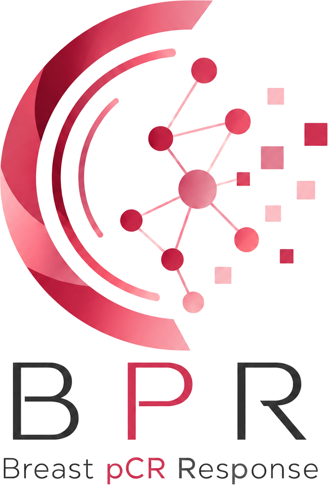
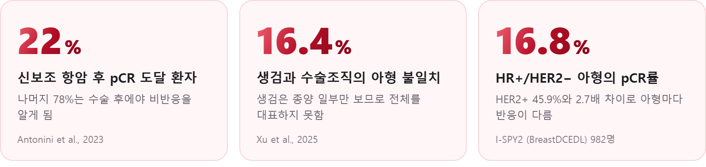
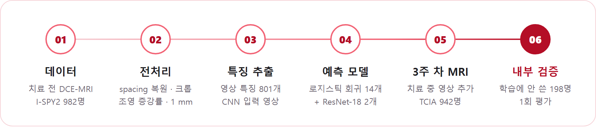
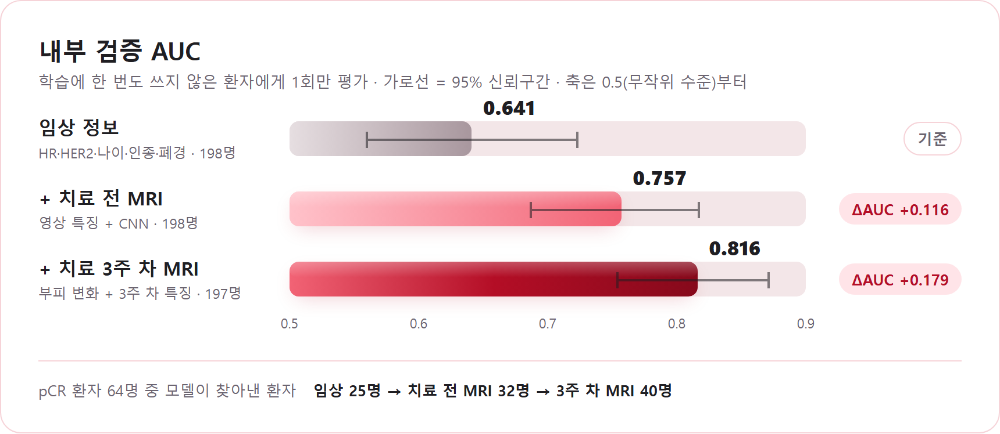
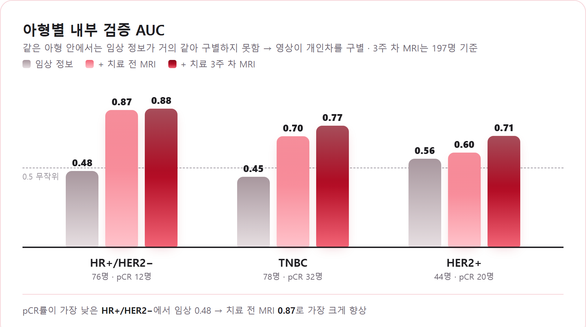
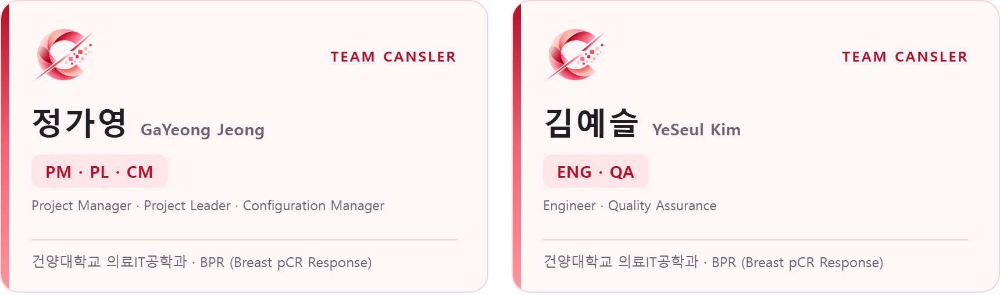

<div align="center">

<picture>
  <source media="(prefers-color-scheme: dark)" srcset="assets/bpr-logo-response-dark.png" />
  
</picture>

<h2>BPR — Breast pCR Response</h2>

<p>
<b>치료 전 유방 MRI로 신보조 항암치료의 완전관해(pCR)를 예측하고,<br/>
영상이 기존 임상 정보를 넘어 예측에 기여하는지 검증합니다.</b>
</p>

<p>
<sub><i>Predicting pathologic complete response (pCR) to neoadjuvant chemotherapy in breast cancer
from pre-treatment DCE-MRI, and testing whether imaging adds value beyond clinical variables.</i></sub>
</p>

<p>


</p>

<p>

</p>

<p>
<a href="#problem">문제 정의</a> ·
<a href="#approach">접근 방법</a> ·
<a href="#data">데이터셋</a> ·
<a href="#results">결과</a> ·
<a href="#code">코드 구성</a> ·
<a href="#method">방법론 · 일정</a> ·
<a href="#team">팀 소개</a>
</p>

</div>

<br/>

<h2 id="problem">01. 문제 정의</h2>

**pCR(병리학적 완전관해)** 은 신보조 항암(수술 전 항암) 후 수술로 떼어 낸 조직에서 침습 암세포가 완전히 사라진 상태입니다.
pCR에 도달한 환자는 그렇지 않은 환자보다 5년 생존·무병생존이 뚜렷이 높습니다(예: 5년 OS 88% vs 58%).
그러나 pCR 여부는 **수술 후 병리 검사로만** 확인할 수 있습니다.

<picture>
  <source media="(prefers-color-scheme: dark)" srcset="assets/problem-stats-dark.png" />
  
</picture>

| # | 문제 | 핵심 근거 |
|:---:|:---|:---|
| **①** | **치료 반응의 불확실성** — pCR 도달은 소수(약 22%)에 그치고, 수술 후 병리로만 확정되어 치료 전에는 알 수 없음 | Antonini et al. (2023); Fang et al. (2024) |
| **②** | **침습적 검사 의존** — 정밀 예측 지표(Ki-67·유전자 등)는 생검 기반인데, 생검은 종양 일부만 떼어 전체를 대표하지 못함 (생검–수술조직 아형 불일치 **16.4%**, 저Ki-67 종양 **32.0%**) | Xu et al. (2025) |
| **③** | **기존 예측 도구의 한계** — 상용 도구(Ataraxis = 병리영상, MammaPrint = 유전자)는 모두 조직 기반·침습이며 비용·접근성 제약, **비침습 MRI 기반 도구는 부재** | Clinical Lab Products (2025); Agendia (2024) |

<br/>

<h2 id="approach">02. 접근 방법</h2>

### 핵심 연구 질문

> **"비침습 MRI 영상이, 아형 등 기존 임상 정보에 *더해* pCR 예측에 추가로 기여하는가?"**

- **비교** — 임상 정보(HR·HER2·나이·인종·폐경) 모델 **vs** 임상 정보 + 영상 모델
- **아형 내 검증** — 같은 아형 안에서도 영상이 pCR을 구별하는지 아형별 성능을 따로 평가
- **추가 분석** — 치료 3주 차 MRI를 더하면 예측이 얼마나 더 좋아지는가

### 분석 흐름

<picture>
  <source media="(prefers-color-scheme: dark)" srcset="assets/analysis-pipeline-dark.png" />
  
</picture>

### 영상 특징 (총 801개)

| 그룹 | 개수 | 내용 |
|:---|:---:|:---|
| 종양 부피 | 1 | 조영 증강 기준 기능적 종양 부피(FTV) |
| 시간 곡선 | 56 | 조영제가 들어오고 빠지는 속도, 곡선 아래 면적 등 (3시점 동역학 + 전체 시점 곡선) |
| Habitat | 37 | 종양 내부를 조영 패턴별 영역으로 나눈 비율·위치 (K-means) |
| 질감 | 665 | PyRadiomics 질감 — 조영 증강률·SER·시간 곡선 지도 |
| 종양 주변 | 42 | 종양 경계 바깥 0–40 mm 고리 영역과 배경 실질 증강 |

### 예측 모델

- **로지스틱 회귀 14개** — 특징 묶음(관점)을 달리해 학습. L1으로 특징을 고른 뒤 L2 로지스틱 회귀로 예측
- **ResNet-18 2개** — 사전학습 CNN을 6채널 시간 증강 영상으로 미세조정 (2.5D·3D)
- **결합** — 16개 모델의 pCR 확률을 **평균**해 최종 예측
- **치료 3주 차 모델** — 3주 차 특징(종양 부피 변화 등)을 더한 로지스틱 회귀 11개 + CNN 1개

<br/>

<h2 id="data">03. 데이터셋</h2>

| 데이터 | 내용 | 규모 | 용도 |
|:---|:---|:---:|:---|
| **BreastDCEDL_ISPY2** | 치료 전 DCE-MRI (NIfTI), 종양 ROI 마스크, 임상 정보·pCR 라벨 | 982명 · 약 54 GB | 주 분석 |
| **TCIA I-SPY2** | 같은 환자의 치료 3주 차 DCE-MRI와 분석 마스크 (DICOM) | 942명 · 약 128 GB | 3주 차 추가 분석 |

- **환자 정보** — pCR, HR, HER2, 나이, 인종, 폐경
- **분할** — 학습 784명 / 내부 검증 198명. 학습 환자로만 5-fold × 20회 교차검증으로 모델을 정하고, 내부 검증 환자는 **마지막에 한 번만** 평가

> 영상 데이터는 용량과 이용 약관 때문에 저장소에 포함하지 않습니다. 각 출처에서 직접 받아야 합니다.

<br/>

<h2 id="results">04. 결과</h2>

<picture>
  <source media="(prefers-color-scheme: dark)" srcset="assets/internal-auc-dark.png" />
  
</picture>

<br/>

<picture>
  <source media="(prefers-color-scheme: dark)" srcset="assets/subtype-auc-dark.png" />
  
</picture>

- 치료 전 MRI만 더해도 AUC가 **0.641 → 0.757** (ΔAUC +0.116, DeLong p < 0.001)
- 치료 3주 차 MRI까지 더하면 **0.816** (95% CI 0.753–0.872)
- 영상의 효과는 **같은 아형 안에서도** 나타남 → 영상이 아형으로 설명되지 않는 개인차를 구별

<details>
<summary>교차검증 단계별 결과 (학습 784명, 5-fold × 20회)</summary>

<br/>

| 단계 | AUC | 임상 대비 ΔAUC |
|:---|:---:|:---:|
| 임상 정보 | 0.656 | — |
| + 종양 부피 | 0.689 | +0.033 |
| + 동역학 | 0.699 | +0.044 |
| + 영상 14관점 결합 | 0.715 | +0.060 |
| + 치료 3주 차 MRI (745명) | 0.770 | +0.117 (같은 745명의 임상 0.653 대비) |

- 내부 검증 결과가 교차검증보다 높게 나왔습니다(0.757 vs 0.715). 표본 구성의 차이일 수 있어 **두 값의 범위로 해석**합니다.
- 보정 곡선(예측 확률과 실제 pCR 비율의 일치)과 모델별 전체 결과는 [`Results/`](Results/)에 있습니다.

</details>

<br/>

<h2 id="code">05. 코드 구성</h2>

```
Code/
├── 00) Settings              경로 · 임상 변수
├── 01) Data                  데이터 통계 · 영상 압축 해제
├── 02) Preprocessing         spacing 복원 · 크롭 · 조영 증강률 · 리샘플링
├── 03) Feature Extraction    동역학 · 종양 주변 · 시간 곡선 · habitat · 질감 · CNN 입력
├── 04) Analysis Table        임상 + 영상 특징 + pCR 라벨
├── 05) Model Training        교차검증 · 로지스틱 회귀 14개
├── 06) CNN Training          ResNet-18 미세조정 (2.5D · 3D)
├── 07) Evaluation            교차검증 AUC · ΔAUC · 아형별 AUC
├── 08) Week-3 MRI Analysis   치료 3주 차 MRI 다운로드 · 특징 · 모델
└── 09) Final Validation      내부 검증 1회 평가
Results/                      모델별 결과 CSV · 그림
```

폴더·파일별 설명, 실행 순서, 결과 파일 안내는 **[GUIDE.md](GUIDE.md)** 에 정리했습니다.

<details>
<summary>기술 스택</summary>

<br/>

| 구분 | 사용 |
|:---|:---|
| 언어 | Python 3.11 |
| 영상 처리 | SimpleITK, pydicom, NumPy, SciPy |
| 특징 추출 | PyRadiomics |
| 모델링 | scikit-learn (로지스틱 회귀), PyTorch · torchvision (ResNet-18, 3D ResNet-18) |
| 데이터 · 시각화 | pandas, Matplotlib |
| 환경 | Windows 11, Conda, NVIDIA CUDA (GPU) |

</details>

<br/>

<h2 id="method">06. 개발 방법론 · 일정</h2>

### 방법론 — 탐색적 프로토타이핑 (PoC 선행) + CRISP-DM

치료 전 MRI 특징으로 pCR 예측이 가능한지는 직접 만들어 보기 전에는 알 수 없었습니다.
그래서 **문제 정의 후 예측 가능성을 먼저 검증(PoC)** 하고, 그 결과로 확인된 유효 특징·모델 구조·실제 발생 위험을 근거로 분석·설계 문서를 작성했습니다.
데이터 분석은 **CRISP-DM** 절차(데이터 준비 → 모델링 → 평가)를 반복하며 진행했습니다.

### 일정

| 기간 | 내용 |
|:---|:---|
| 2026.08.27 ~ 2026.12.11 | 전체 프로젝트 (설계 및 프로젝트 기본) |
| 2026.10.02 ~ 2026.10.08 | 구현 — 전처리 → 특징 추출 → 모델 학습 → 3주 차 추가 분석 → 내부 검증 |
| 2026.10 ~ | 분석·설계 문서 작성, 포스터·발표 (KY-FESTA) |

<br/>

<h2 id="scope">07. 구현 범위 · 향후 계획</h2>

### 구현 범위와 보완점

- 본 프로젝트는 비침습 MRI 영상이 기존 임상 정보에 더해 pCR 예측에 기여하는 정도를 **정량적으로 확인하는 탐색적 연구**입니다.
- 기준 모델은 데이터에서 확보할 수 있는 임상 정보(HR·HER2·나이·인종·폐경)로 구성했으며, 종양 크기는 MRI에서 계산한 종양 부피로 반영했습니다. 종양 등급·Ki-67 등 임상 정보를 더하면 비교 기준을 한층 보완할 수 있습니다.
- 성능은 **I-SPY2 내부 검증(198명)** 으로 확인했으며, 다른 기관 데이터를 통한 외부 검증으로 범용성을 넓혀 갈 예정입니다.
- 의료진용 화면(업로드·종양 오버레이·확률 표시)은 개념 설계를 마쳤으며, 웹 시각화로 구현해 나갈 계획입니다.

### 향후 계획

| | 계획 | 내용 |
|:---:|:---|:---|
| 1 | **외부 데이터셋 검증** | 다른 기관 데이터로 재현성을 확인해 범용 예측 모델 구축 |
| 2 | **치료 중 MRI 추적** | 미사용 치료 중기(T2)·수술 전(T3) MRI까지 활용해 조기 반응 예측 고도화 |
| 3 | **의료진용 웹 시각화** | 예측 확률과 근거를 보여주는 화면으로 임상 활용 가능성 확보 |

<br/>

<h2 id="team">Team CANSLER</h2>

<picture>
  <source media="(prefers-color-scheme: dark)" srcset="assets/team-cards-dark.png" />
  
</picture>

<p align="center"><b>정가영</b> GaYeong Jeong &nbsp;·&nbsp; <b>김예슬</b> YeSeul Kim &nbsp;|&nbsp; 지도교수 <b>한주혁</b></p>

<br/>

## 참고 문헌

- Antonini, M., et al. (2023). Real-world evidence of neoadjuvant chemotherapy for breast cancer treatment in a Brazilian multicenter cohort. *The Breast, 72*, 103577. https://doi.org/10.1016/j.breast.2023.103577
- Fang, S., et al. (2024). A real-world clinicopathological model for predicting pathological complete response to neoadjuvant chemotherapy in breast cancer. *Frontiers in Oncology, 14*, 1323226. https://doi.org/10.3389/fonc.2024.1323226
- Xu, M., et al. (2025). Expression and subtype discordance between core needle biopsy and surgical specimen in breast cancer. *Journal of Surgical Research, 307*, 42–52. https://doi.org/10.1016/j.jss.2025.01.010
- Shi, Z., et al. (2023). MRI-based quantification of intratumoral heterogeneity for predicting treatment response to neoadjuvant chemotherapy in breast cancer. *Radiology, 308*(1), e222830. https://doi.org/10.1148/radiol.222830
- Clinical Lab Products. (2025). *AI test predicts neoadjuvant response in early breast cancer.* https://clpmag.com/disease-states/cancer/breast/ai-test-predicts-neoadjuvant-response-early-breast-cancer/
- Agendia. (2024). *New neoadjuvant trial (MINT) confirms the predictive utility of MammaPrint & BluePrint.* https://agendia.com/neoadjuvant-mint-trial-confirms-predictive-utility-of-mammaprint-blueprint/

## 데이터 출처

- **BreastDCEDL** — I-SPY2 치료 전 DCE-MRI · 종양 마스크 · 임상 정보 (Zenodo 배포, CC BY-NC 4.0)
- **The Cancer Imaging Archive (TCIA), I-SPY2 / ACRIN 6698** — 치료 3주 차 DCE-MRI · 분석 마스크 (CC BY 4.0). https://www.cancerimagingarchive.net/collection/ispy2/

<br/>

<div align="center">
<sub>2026 KY-FESTA · 건양대학교 의료IT공학과 · Team CANSLER</sub>
</div>
